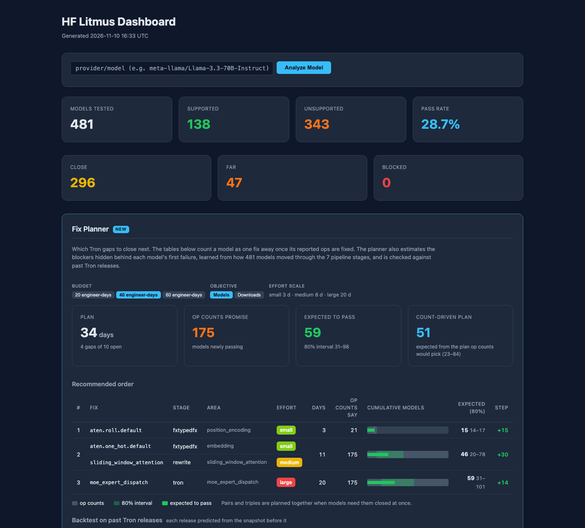

# Fix Planner for hf-litmus (concept)

**Live demo:** https://mohith26.github.io/positron-ai-fix-planner/

An unofficial concept feature for [hf-litmus](https://github.com/positron-ai/hf-litmus), Positron AI's continuous model-compatibility tester for the Tron compiler, built by Mohith Gajjela. Not affiliated with Positron AI. The page is hf-litmus's own dashboard (rendered by its `_render_html`, vendored under its BSD-3-Clause license) with one new section.



## What it is

hf-litmus runs Hub models through `torch.export` and Tron's stages (fxtypedfx, rewrite, bulk, loopy, tron, cpp) and reports where each one first breaks and which ops are missing. Its dashboard then counts how many models each missing op or feature area affects, and its heuristic calls a model "close" when it has two or fewer missing ops.

Those counts answer "how many models report this gap", not "how many models will pass if we fix it". The pipeline stops at the first failure, so whatever waits at later stages is invisible until the first blocker is gone. Fix Planner estimates that hidden part and plans around it:

- **Expected to pass** for any set of fixes, with an 80% interval, next to what the op counts promise.
- **A recommended order** of fixes under an engineer-day budget, choosing pairs or triples together when models need them closed at once.
- **A backtest** on past Tron releases: each release predicted from the snapshot before it.
- **A map of where hidden blockers wait**: the chance each architectural feature causes a blocker at each stage, with cells that no model has reached marked as prior-driven.

On the demo history, four releases shipped fixes that the op counts said would unblock **252** models. **72** actually started passing; the planner predicted **72**, and every release landed inside its 80% interval. The starkest case is the release that fixed data-dependent expert routing in `torch.export`: the counts said 98 models, 7 passed, the planner said 7, because almost every MoE model that got past export hit `aten.index_put` or `aten.one_hot` next.

## How it works

1. **Records** (`core/fixplan.js: prepare`). For each model: the stage of its first failure, the ops/patterns/kernels reported there, and for deep-analysed models (hf-litmus's Claude Code pass) the furthest stage reached and the gaps found on the way.
2. **Discrete-time survival over pipeline stages** (`survivalRows`). A model contributes a row for every stage it is known to have reached: 0 if it got through, 1 if it was blocked. It is censored where knowledge ends. Under a counterfactual fix set F, known blockers in F are treated as fixed, so a model moves forward in the data and the rows reflect what F would reveal.
3. **Noisy-OR hazards** (`fitNoisyOr`). At each stage, every feature a model has (MoE, hybrid/linear attention, sliding window, MLA, vision tower, YaRN, softcapping, quantization, vocab > 200k, taken from its public config.json) is an independent possible cause of a blocker, plus a baseline cause: P(blocked) = 1 - (1 - q0) * prod(1 - qf). Fit by EM with Beta priors; the posterior for each cause strength comes from EM's expected counts.
4. **Prior chosen by backtest.** Feature-stage pairs that no model has reached are driven by the prior. Beta(0.2, 0.8) (mean 0.2, U-shaped: most pairs need nothing, a few need real work) was chosen by walk-forward backtest error over a grid of prior means. I tried two alternatives first. A ridge-logistic hazard per stage scored slightly better on the backtest (mean error 1.2 vs 1.8 models per release) but cannot represent a feature that is always blocked at a stage under a shared intercept (8 of 8 hybrids blocked at loopy came out at 38%), and it over-promised on the forward plan by about 40 models in the ground-truth check below. An empirical-Bayes Beta prior estimated from well-observed cells came out at mean 0.37 and was too pessimistic (66 predicted vs 72). Note that the forward-plan comparison used the hidden truth, so the final model choice was informed by it.
5. **Expected passes** (`gate`, `posteriorSurvival`, `expected`, `interval`). A model can pass only if every blocker we know about is in F. Its chance of passing is the posterior-mean probability that nothing hidden waits at the stages beyond what we know. Intervals use common posterior draws plus Bernoulli outcomes.
6. **Planning** (`plan`). Greedy by expected gain per engineer-day (small 3, medium 8, large 20 days), also trying pairs and triples that beat their parts. Each candidate is scored with hazards re-fit as if it had shipped, which is what stops the planner from buying `aten.cumsum` + `aten.conv1d` for the hybrids: once those ops are fixed in the data, the deep-analysed hybrids show `gated_delta_rule` and `linear_attention_recurrence` waiting behind them.
7. **Bug-fix churn** (`walkForward`). Models stuck on an unnamed, model-specific error sometimes pass because of ordinary fixes. That rate is learned from earlier releases only and added to the backtest predictions.

## Tests

```
node --test tests/fixplan.test.mjs
```

8 tests: Beta/Gamma samplers; noisy-OR EM recovering known cause strengths; survival-row censoring (fixed blockers move a model forward, deep analysis extends what is known); gate and pass-probability semantics; the walk-forward backtest (every release inside its 80% interval, planner error under a tenth of the op-count error, the expert-routing release at 98 promised / 7 actual / about 7 predicted); planner budget and determinism; a ground-truth check against the hidden rules (`scripts/oracle.py`: the planner's 40-day plan unblocks more models than the count-driven plan, and every step's interval covers the true count); data integrity and the vendored dashboard markup.

## Data

- **Public:** 481 text-generation models from the Hugging Face Hub (trending and most-downloaded lists, fetched 2026-11-10), with real downloads, likes and config.json-derived features. Tags use hf-litmus's own `_tags_from_config_attrs` rules. `scripts/snapshot.py` rebuilds `data/hub_snapshot.json`.
- **Synthetic:** which stage each model fails at. `scripts/generate.py` holds a hidden catalog of 27 Tron gaps with matching rules over the real configs (for example, MoE models need `aten.scatter_add`, hybrids need `aten.cumsum` and a linear-attention recurrence kernel), model-specific bugs, and six simulated releases v0.31 to v0.36. The planner never reads those rules. Real model names appear with invented results; nothing here says how any model actually fares on Tron.

Ground-truth check for the default 40-day plan (`python3 scripts/oracle.py G9,G12,P1,T1`): it unblocks 85 models. The plan the op counts would pick with the same budget unblocks 72, while promising 296. The planner predicted 59 (80% interval 31-98) for its own plan: conservative, but covering the truth.

## Limitations

- The litmus outcomes are synthetic, so the backtest only shows the method works on data with this structure. Its real test is the actual `litmus-outputs` history across Tron versions.
- The prior mean was tuned on the same four releases it is scored on. With nested walk-forward tuning (each release's prior picked from earlier releases only, three releases), two of three land inside the 80% interval (the v0.35 release is under-predicted: 17 vs 22).
- Features are binary flags from config.json. Two models with the same flags but different implementations (for example custom MoE routing) look identical to the planner.
- Effort per gap is a three-level guess, not Tron team estimates.
- Assumes a failing stage reports all of its missing ops at once, and that fixes do not break passing models.
- Download-weighted intervals are wide because downloads are heavy-tailed.

## Novelty note

hf-litmus today counts models per missing op and feature area, lists "High-Impact Failures" by downloads (`summary_generator.py`), and labels models close/far/blocked with a per-model heuristic. I found nothing in the repository, its README, or Positron's public pages that estimates blockers hidden behind the first failure, backtests predictions against releases, or orders fixes by expected passes. I did not find a comparable public tool from other inference-silicon vendors either; their model-support pages list supported models rather than forecasting.

## Attribution

`vendor/hf_litmus/` contains `dashboard.py`, `feature_areas.py`, `models.py` and `__init__.py` from positron-ai/hf-litmus, unmodified, under the BSD 3-Clause License (Copyright (c) 2026, John Wiegley; see `vendor/hf_litmus/LICENSE.md`). `scripts/build.py` calls them to render the page and adds the Fix Planner section, a stylesheet, and a small shim that answers the dashboard's `/api` calls on static hosting.
